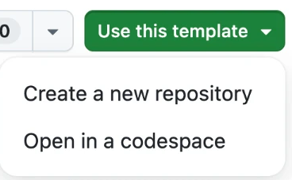

# יומן פרומפטים

## 2026-11-01

**22:27 · claude**

> <ide_selection>The user selected the lines 1 to 100 from c:\Users\User\OneDrive\לימודים\סמסטר ג\פיתוח WEB ושימוש בAI\DisneyCatalog\README.md:
> # נקודת פתיחה לפרויקט הגמר · יומן פרומפטים אוטומטי
> 
> ב-repo הזה יש דבר אחד: **רישום אוטומטי של כל פרומפט שאתם שולחים לסוכן**, אל תוך `PROMPTS.md`.
> את האפליקציה אתם בונים בעצמכם, לפי הוראות הפרויקט.
> 
> ## מתחילים
> 
> **1 · יוצרים repo משלכם.** היכנסו ל-GitHub עם המשתמש שלכם, ופתחו את הקישור:
> **[יצירת repo חדש מהתבנית](https://github.com/new?template_name=react-project-starter&template_owner=YarivGilad)**.
> תנו לו שם, בחרו **Public**, ולחצו **Create repository**.
> 
> אפשר גם מהעמוד הזה: כשאתם מחוברים ל-GitHub, בפינה הימנית העליונה מופיע הכפתור **Use this template** ← **Create a new repository**.
> בלי חיבור ל-GitHub הכפתור לא מופיע.
> 
> 
> 
> **2 · מורידים אותו למחשב.**
> 
> ```bash
> git clone https://github.com/<שם-המשתמש-שלכם>/<שם-הפרויקט>.git
> cd <שם-הפרויקט>
> ```
> 
> **3 · בודקים שהיומן עובד.** פתחו את הסוכן **מתוך תיקיית הפרויקט**, שלחו לו הודעה כלשהי, ואז:
> 
> ```bash
> tail -n 20 PROMPTS.md
> ```
> 
> רואים את ההודעה? מצוין. לא רואים? ראו "כשזה לא עובד" למטה. **אל תמשיכו לפני שזה עובד.**
> 
> **4 · יוצרים את אפליקציית Vite באותה תיקייה** (שימו לב לנקודה אחרי `@latest`):
> 
> ```bash
> npm create vite@latest . -- --template react-ts
> ```
> 
> כשמופיעה השאלה `Current directory is not empty`, בחרו **Ignore files and continue**.
> 
> > ⚠️ **לא** לבחור `Remove existing files and continue` — זה מוחק את ה-hooks ואת `PROMPTS.md`, והיומן נעלם.
> 
> Vite יחליף את `README.md` ואת `.gitignore` בגרסאות שלו. זה בסדר: את ה-README תכתבו מחדש, על הפרויקט שלכם.
> 
> **5 · commit ראשון**, ומשם — משימה אחת בכל פעם, ו-commit אחרי כל משימה.
> 
> ## מה יש כאן
> 
> ```
> .claude/settings.json        hook ל-Claude Code
> .codex/hooks.json            hook ל-Codex
> .gemini/settings.json        hook ל-Gemini CLI
> .agents/hooks.json           hook ל-Antigravity
> .github/hooks/log-prompt.json  hook ל-GitHub Copilot (ב-VS Code וב-Copilot CLI)
> scripts/log-prompt.mjs       הסקריפט שכותב ל-PROMPTS.md
> AGENTS.md, CLAUDE.md         כללי עבודה לסוכן: משימה אחת בכל פעם, בלי commit בשבילכם
> PROMPTS.md                   היומן — נכתב אוטומטית
> ```
> 
> ## איך היומן עובד
> 
> לסוכנים יש **hooks**: נקודות שבהן הם מריצים פקודה משלכם. כאן מחובר hook שרץ **בכל פעם שאתם שולחים הודעה לסוכן**.
> הוא מעביר את הפרומפט לסקריפט `scripts/log-prompt.mjs`, והסקריפט מוסיף אותו ל-`PROMPTS.md` עם השעה ושם הסוכן.
> 
> ```markdown
> ## 2026-10-14
> 
> **18:42 · claude**
> 
> > תוסיף שדה חיפוש מעל הרשימה
> 
> **18:55 · claude**
> 
> > החיפוש מוחק את הרשימה כשמוחקים את כל האותיות. תתקן
> ```
> 
> הרשומה השנייה היא בדיוק מה שאנחנו מחפשים: **תהליך**. ניסיון, בדיקה, תיקון.
> 
> | סוכן | הערה |
> |---|---|
> | **Claude Code** | בהפעלה הראשונה צריך לאשר את ה-hook פעם אחת. |
> | **Codex CLI** | אוטומטי. |
> | **Gemini CLI** | בהפעלה הראשונה תופיע אזהרה על hook חדש בפרויקט. זה ה-hook הזה. |
> | **Antigravity** | ה-hook לא מקבל את הפרומפט עצמו, אז הרשומה מופיעה רק כשהסוכן מסיים לענות. |
> | **GitHub Copilot** | ב-VS Code: צריך לאשר שאתם סומכים על התיקייה (Trust). |
> | **כלים אחרים** (Cursor ועוד) | אין hook. ב-`AGENTS.md` יש הוראה לסוכן לרשום כל הודעה בעצמו — ודאו שהוא עושה את זה. |
> 
> ## כשזה לא עובד
> 
> - ודאו ש-`node -v` מציג מספר גרסה.
> - ודאו שפתחתם את הסוכן **מתוך תיקיית הפרויקט**, ולא מתיקייה מעליה.
> - עדיין לא עובד? הוסיפו את הרשומה בעצמכם, באותו פורמט, ותגידו לי.
> 
> ## היומן והציון
> 
> - **commit ל-`PROMPTS.md` יחד עם הקוד**, אחרי כל משימה.
> - אחרי כל משימה הוסיפו שורה משלכם: מה בדקתם, ומה שיניתם בעצמכם.
> - אל תערכו את היומן בדיעבד כדי שייראה יפה. יומן מסודר מדי בולט לרעה.
> 
> > **פרטיות:** כל מה שאתם כותבים לסוכן נשמר בקובץ ועולה ל-GitHub. אל תכתבו בפרומפטים סיסמאות, מפתחות, או פרטים אישיים של מישהו.
> 
> 
> This may or may not be related to the current task.</ide_selection>
> 
> 
> <pasted_content id="c125">
> You are a product manager helping a first-year student plan a small React web app.
> The app is a master-detail app: a list of items, and a details panel for the item I click.
> The data comes from a free public API that needs no key.
> 
> Interview me one question at a time, at most 8 questions, until you know:
> who the app is for, what they want to do, which API to use,
> and which fields to show in the list and in the details panel.
> Talk with me in the language I write in.
> 
> Then write PRD.md in English: one page, plain language, no code, with these sections:
> 1. One-sentence pitch
> 2. Who it is for
> 3. Screens (list, details)
> 4. Must-have features (at most 5)
> 5. Acceptance criteria: 3 to 5 lines, each written as "When I ..., I see ..."
> 6. Not now (ideas for later)
> 7. Data: the API URL and the fields we use
> </pasted_content id="c125">

**22:28 · claude**

> The website is designed for Disney fans, children, and adults who want to explore Disney characters and learn more about them.

**22:31 · claude**

> Users want to browse a catalog of Disney characters, view their images, search for their favorite characters by name, mark characters as favorites, and click on a character to see more information about it.

**22:32 · claude**

> <pasted_content id="c125">
> We will use the Disney Characters API, a free public API that provides information about Disney characters in JSON format.
> 
> API URL:
> 
> https://api.disneyapi.dev/character
> </pasted_content id="c125">

**22:34 · claude**

> yes, those are the field that i want to show: Character image
> Character name
> A favorite button (heart icon)

**22:36 · claude**

> <pasted_content id="c125">
> the details panel will display:
> - Character image.
> - Character name.
> - Films featuring the character.
> - TV shows featuring the character.
> - Video games featuring the character.
> - Allies.
> - Enemies.
> - Disney park attractions.
> </pasted_content id="c125">
> 
>          The details panel will display only categories that contain available information for the selected character. Empty or unavailable categories will be hidden to keep the interface clean and organized.

**22:42 · claude**

> Both A and B, with the following functionality:
> 
> Users can click a heart-shaped button to add or remove a character from their favorites. Favorites will be saved in the browser (localStorage), so they remain saved even after refreshing the page. The website will also include a separate Favorites page where users can view all the characters they have marked as favorites.

**22:45 · claude**

> i want option A

**22:48 · claude**

> Pop-up Window (Modal)
> 
> When a user clicks on a character card, it will expand into a larger pop-up window in the center of the screen, displaying the character's image, name, and all available information. Only categories with available data will be shown. The pop-up will include a close button (X) to return to the character catalog.

**23:21 · claude**

> <ide_opened_file>The user opened the file c:\Users\User\OneDrive\לימודים\סמסטר ג\פיתוח WEB ושימוש בAI\DisneyCatalog\PRD.md in the IDE. This may or may not be related to the current task.</ide_opened_file>
> 
> 
> <pasted_content id="c125">
> I want to make a few updates to the project before we continue.
> 
> Please divide the information below into two parts:
> 
> Part 1 – Update the PRD
> 
> Please update the existing PRD with the following information, while keeping all the decisions and information we already discussed.
> 
> Pages and website functionality:
> 
> Main Catalog Page (/characters)
> 
> Shows Disney character cards with their images and names.
> 
> Each card has a heart button to add or remove the character from favorites.
> 
> Includes a search bar to search for characters by name.
> 
> Initially shows 50 characters, with a "Load More" button that loads the next 50 and adds them to the existing list.
> 
> Favorites Page (/favorites)
> 
> Shows all the characters the user has marked as favorites.
> 
> Users can add or remove characters from their favorites using the heart button.
> 
> Favorites should remain saved even after refreshing the browser.
> 
> Random Character Page (/random)
> 
> Shows one random Disney character, including their image and name.
> 
> Includes a button to generate another random character.
> 
> The user can also open the character's details.
> 
> Character Details (/characters/:id)
> 
> When clicking a character, a larger pop-up/modal should open over the catalog.
> 
> It should show the character's image, name, and all the information available for that character.
> 
> Information categories that are empty or unavailable should not be displayed.
> 
> The URL should change to the character's unique URL when the modal opens.
> 
> Closing the modal should return the user to the catalog.
> 
> Opening a character's URL directly should also open the correct character's modal.
> 
> One important thing about the page structure: the assignment requires a main page and at least two additional pages. The Favorites page and the Random Character page are the two additional pages. The character details should still look like a pop-up over the catalog, not like a completely separate page, even though it has its own URL.
> 
> Please keep the existing seven PRD sections and try to keep the document around one page. Don't remove decisions we have already made.
> 
> Part 2 – Keep these requirements in mind for the rest of the project
> 
> These are course requirements and development instructions. They don't all need to appear in the PRD, but I want you to keep them in mind when creating the tasks and developing the project.
> 
> Technologies:
> 
> React with Vite and TypeScript.
> 
> React Router for navigation.
> 
> Vitest for unit tests.
> 
> Custom CSS for styling.
> 
> Front-end only. No backend or database.
> 
> React and TypeScript requirements:
> 
> Use type or interface for API data and component props. Don't use any.
> 
> Create at least 4 custom reusable components, not including page components. Each component should be in its own file.
> 
> Use map to display lists, with a unique key for every item.
> 
> Pass information between components using props.
> 
> Use useParams to get character IDs from the URL.
> 
> Use Link or NavLink for navigation.
> 
> API requirements:
> 
> Fetch data from the Disney API using fetch inside useEffect.
> 
> API URL: https://api.disneyapi.dev/character
> 
> Include loading, error, and success states.
> 
> Don't assume every character has all the same information. Only display data that is actually available.
> 
> Testing requirements:
> 
> At least 5 passing unit tests using Vitest.
> 
> Tests should run with npm test.
> 
> Install @vitest/ui, add a test:ui script, and make sure npm run test:ui works.
> 
> Other course requirements:
> 
> The website should look good on mobile and narrow screens.
> 
> Include a README.md explaining what the project does, how to run it, how to run the tests, and which API it uses.
> </pasted_content id="c125">
> 
>      For now, please only update the existing PRD.md. Don't start coding or implementing anything yet. After that, we'll move on to creating the task list.

**23:24 · claude**

> <pasted_content id="c125">
> Read the PRD above. Write tasks.md: at most 8 tasks, in build order.
> Each task must be small enough for one commit, and end with a "Done when:" line.
> Task 1: show the list using a few sample items saved in a local JSON file (no API yet).
> Task 2: click an item to show its details.
> No code.
> </pasted_content id="c125">

**23:32 · claude**

> <pasted_content id="c125">
> The task order looks good to me! Before we start coding, I just want to make sure all the course requirements are covered in the actual tasks.md.
> 
> Please check the following:
> 
> We need at least 5 passing unit tests by the end of the project, and they should test our own logic.
> 
> The Random Character page should allow the user to generate another random character and open that character's details pop-up.
> 
> Make sure all TypeScript requirements are included: use type or interface for API data and component props, and don't use any.
> 
> We need at least 4 reusable components (not including page components), with each component in its own separate file.
> 
> Make sure we use React Router correctly, including useParams for character IDs and Link or NavLink for navigation.
> 
> Make sure all pages we planned are included: the main catalog, Favorites, Random Character, and the character details pop-up with its own URL.
> 
> Don't forget the mobile responsiveness requirement and the README.
> 
> If anything is missing from the tasks, please update tasks.md so all the requirements are covered in the right tasks.
> </pasted_content id="c125">
> 
>   For now, don't start implementing anything or writing code.

**23:39 · claude**

> <ide_selection>The user selected the lines 1 to 107 from c:\Users\User\OneDrive\לימודים\סמסטר ג\פיתוח WEB ושימוש בAI\DisneyCatalog\PROMPTS.md:
> # יומן פרומפטים
> 
> ## 2026-11-01
> 
> **22:27 · claude**
> 
> > <ide_selection>The user selected the lines 1 to 100 from c:\Users\User\OneDrive\לימודים\סמסטר ג\פיתוח WEB ושימוש בAI\DisneyCatalog\README.md:
> > # נקודת פתיחה לפרויקט הגמר · יומן פרומפטים אוטומטי
> > 
> > ב-repo הזה יש דבר אחד: **רישום אוטומטי של כל פרומפט שאתם שולחים לסוכן**, אל תוך `PROMPTS.md`.
> > את האפליקציה אתם בונים בעצמכם, לפי הוראות הפרויקט.
> > 
> > ## מתחילים
> > 
> > **1 · יוצרים repo משלכם.** היכנסו ל-GitHub עם המשתמש שלכם, ופתחו את הקישור:
> > **[יצירת repo חדש מהתבנית](https://github.com/new?template_name=react-project-starter&template_owner=YarivGilad)**.
> > תנו לו שם, בחרו **Public**, ולחצו **Create repository**.
> > 
> > אפשר גם מהעמוד הזה: כשאתם מחוברים ל-GitHub, בפינה הימנית העליונה מופיע הכפתור **Use this template** ← **Create a new repository**.
> > בלי חיבור ל-GitHub הכפתור לא מופיע.
> > 
> > 
> > 
> > **2 · מורידים אותו למחשב.**
> > 
> > ```bash
> > git clone https://github.com/<שם-המשתמש-שלכם>/<שם-הפרויקט>.git
> > cd <שם-הפרויקט>
> > ```
> > 
> > **3 · בודקים שהיומן עובד.** פתחו את הסוכן **מתוך תיקיית הפרויקט**, שלחו לו הודעה כלשהי, ואז:
> > 
> > ```bash
> > tail -n 20 PROMPTS.md
> > ```
> > 
> > רואים את ההודעה? מצוין. לא רואים? ראו "כשזה לא עובד" למטה. **אל תמשיכו לפני שזה עובד.**
> > 
> > **4 · יוצרים את אפליקציית Vite באותה תיקייה** (שימו לב לנקודה אחרי `@latest`):
> > 
> > ```bash
> > npm create vite@latest . -- --template react-ts
> > ```
> > 
> > כשמופיעה השאלה `Current directory is not empty`, בחרו **Ignore files and continue**.
> > 
> > > ⚠️ **לא** לבחור `Remove existing files and continue` — זה מוחק את ה-hooks ואת `PROMPTS.md`, והיומן נעלם.
> > 
> > Vite יחליף את `README.md` ואת `.gitignore` בגרסאות שלו. זה בסדר: את ה-README תכתבו מחדש, על הפרויקט שלכם.
> > 
> > **5 · commit ראשון**, ומשם — משימה אחת בכל פעם, ו-commit אחרי כל משימה.
> > 
> > ## מה יש כאן
> > 
> > ```
> > .claude/settings.json        hook ל-Claude Code
> > .codex/hooks.json            hook ל-Codex
> > .gemini/settings.json        hook ל-Gemini CLI
> > .agents/hooks.json           hook ל-Antigravity
> > .github/hooks/log-prompt.json  hook ל-GitHub Copilot (ב-VS Code וב-Copilot CLI)
> > scripts/log-prompt.mjs       הסקריפט שכותב ל-PROMPTS.md
> > AGENTS.md, CLAUDE.md         כללי עבודה לסוכן: משימה אחת בכל פעם, בלי commit בשבילכם
> > PROMPTS.md                   היומן — נכתב אוטומטית
> > ```
> > 
> > ## איך היומן עובד
> > 
> > לסוכנים יש **hooks**: נקודות שבהן הם מריצים פקודה משלכם. כאן מחובר hook שרץ **בכל פעם שאתם שולחים הודעה לסוכן**.
> > הוא מעביר את הפרומפט לסקריפט `scripts/log-prompt.mjs`, והסקריפט מוסיף אותו ל-`PROMPTS.md` עם השעה ושם הסוכן.
> > 
> > ```markdown
> > ## 2026-10-14
> > 
> > **18:42 · claude**
> > 
> > > תוסיף שדה חיפוש מעל הרשימה
> > 
> > **18:55 · claude**
> > 
> > > החיפוש מוחק את הרשימה כשמוחקים את כל האותיות. תתקן
> > ```
> > 
> > הרשומה השנייה היא בדיוק מה שאנחנו מחפשים: **תהליך**. ניסיון, בדיקה, תיקון.
> > 
> > | סוכן | הערה |
> > |---|---|
> > | **Claude Code** | בהפעלה הראשונה צריך לאשר את ה-hook פעם אחת. |
> > | **Codex CLI** | אוטומטי. |
> > | **Gemini CLI** | בהפעלה הראשונה תופיע אזהרה על hook חדש בפרויקט. זה ה-hook הזה. |
> > | **Antigravity** | ה-hook לא מקבל את הפרומפט עצמו, אז הרשומה מופיעה רק כשהסוכן מסיים לענות. |
> > | **GitHub Copilot** | ב-VS Code: צריך לאשר שאתם סומכים על התיקייה (Trust). |
> > | **כלים אחרים** (Cursor ועוד) | אין hook. ב-`AGENTS.md` יש הוראה לסוכן לרשום כל הודעה בעצמו — ודאו שהוא עושה את זה. |
> > 
> > ## כשזה לא עובד
> > 
> > - ודאו ש-`node -v` מציג מספר גרסה.
> > - ודאו שפתחתם את הסוכן **מתוך תיקיית הפרויקט**, ולא מתיקייה מעליה.
> > - עדיין לא עובד? הוסיפו את הרשומה בעצמכם, באותו פורמט, ותגידו לי.
> > 
> > ## היומן והציון
> > 
> > - **commit ל-`PROMPTS.md` יחד עם הקוד**, אחרי כל משימה.
> > - אחרי כל משימה הוסיפו שורה משלכם: מה בדקתם, ומה שיניתם בעצמכם.
> > - אל תערכו את היומן בדיעבד כדי שייראה יפה. יומן מסודר מדי בולט לרעה.
> > 
> > > **פרטיות:** כל מה שאתם כותבים לסוכן נשמר בקובץ ועולה ל-GitHub. אל תכתבו בפרומפטים סיסמאות, מפתחות, או פרטים אישיים של מישהו.
> > 
> 
> This may or may not be related to the current task.</ide_selection>
> 
> 
> <pasted_content id="c125">
> I reviewed the tasks.md and it looks really good! I just want to make a few small changes before we start coding:
> 
> PROMPTS.md: This file is already updated automatically by the project's hooks every time I send you a prompt. Please don't edit it or manually add prompts to it. However, after each completed task, remind me to add my own short note describing what I checked and what I changed myself, as required by the project instructions. I will add this note myself.
> 
> Task 4 – API: Please make sure you verify the actual Disney API response structure and pagination before implementing it. Don't assume the API always returns exactly 50 characters per request.
> 
> Task 5 – Search: Since searching also involves API requests, please include loading and error states for search as well, not just a "No characters found" message.
> 
> Task 7 – Random Character: Make sure clicking "Show another" doesn't immediately show the same character again.
> 
> Please update only the relevant parts of tasks.md. Keep the existing 8 tasks and their order, and don't remove any of the requirements that are already included
> </pasted_content id="c125">
> 
> .   Don't start coding or implementing anything yet.

## 2026-11-02

**00:44 · claude**

> <ide_opened_file>The user opened the file c:\Users\User\OneDrive\לימודים\סמסטר ג\פיתוח WEB ושימוש בAI\DisneyCatalog\tasks.md in the IDE. This may or may not be related to the current task.</ide_opened_file>
> 
> 
> <pasted_content id="c125">
> Read PRD.md and tasks.md, then implement **Task 1 only**.
> 
> Follow the existing project requirements and keep the implementation simple and beginner-friendly.
> 
> Do not start any other tasks or modify PROMPTS.md manually, as prompt logging is handled automatically.
> 
> When finished, run `npm run build` and explain briefly what you implemented and which files you created.
> 
> Do not commit or push.
> </pasted_content id="c125">

Task 1 – Personal Review:
I checked that the website runs correctly, displays all six sample characters, and shows a placeholder for a character with a missing image. I also reviewed the basic layout and confirmed that the project builds successfully. I did not make any code changes myself.
